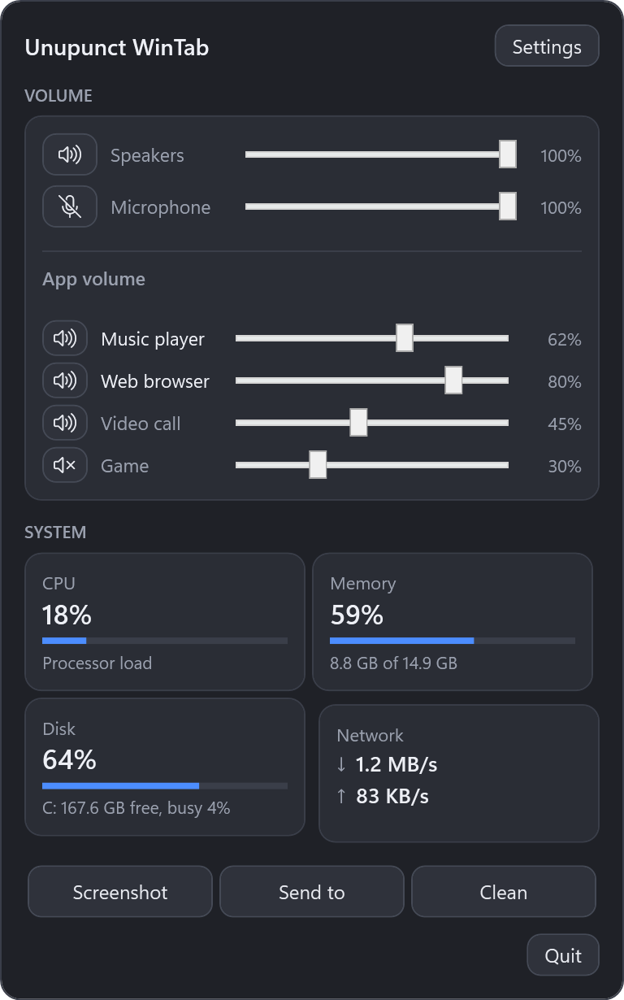
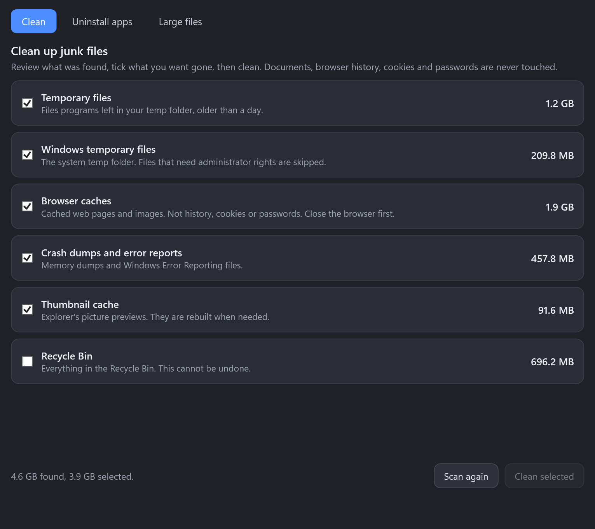
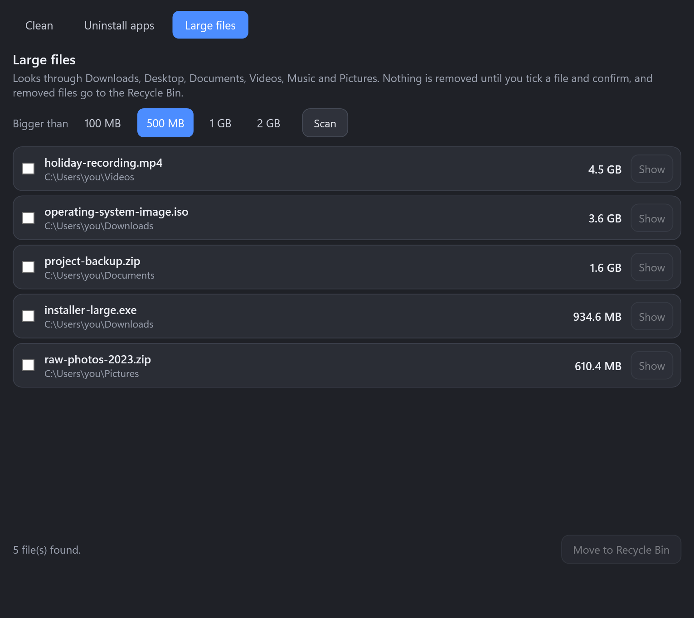
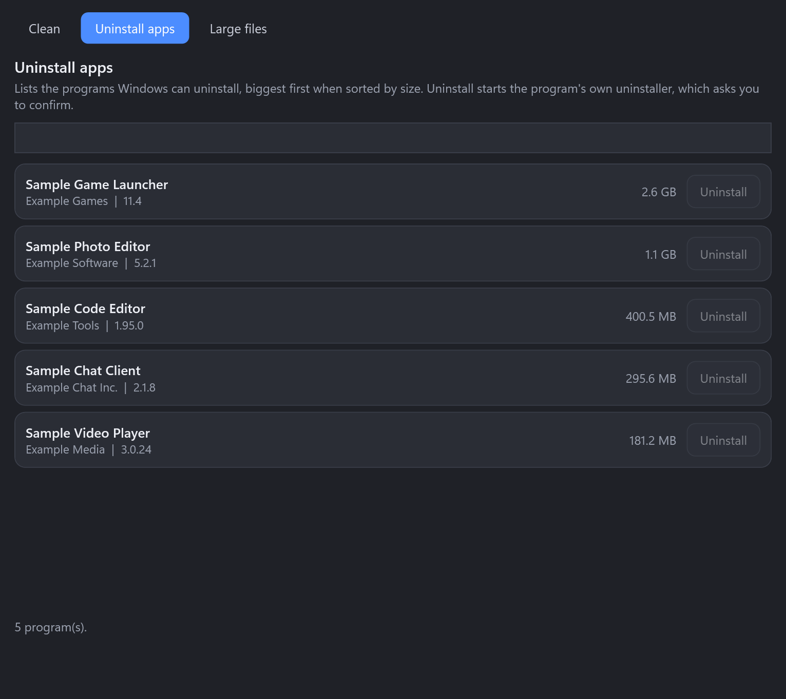

# Unupunct WinTab

**A Windows 11 tray utility: volume for every app, live CPU / RAM / disk / network readings, screenshots, "Send to" and a cleaner.**
It is the Windows companion of [Unupunct's MacTab](https://github.com/unupunct/Unupunct-s-MacTab): the same ideas, written from scratch for Windows (C# / .NET 10 / WPF). It shares no code with the Mac app.

<p align="center">
  
</p>
<p align="center"><sub>The screenshots show demo data (made-up apps and files), not a real PC.</sub></p>

> **Read this first.** This is version 0.1.0, written and tested on one Windows 11 PC. The cleaning and
> removal parts have unit tests on temporary folders, but they have not been used on many machines. Look at
> what the cleaner found before you press **Clean**.

## What it does

- **Volume.** Click the tray icon for the output and microphone sliders with mute buttons, and **one slider per app** that is using sound (Windows allows that), with a mute button for each.
- **Readings next to the tray.** A small strip left of the tray icons shows `CPU 12%  RAM 48%  DSK 36%  ↓1.2M ↑85K`; click it to open the panel. The tray icon itself shows the CPU load as a number. The strip can be switched off in Settings.
- **Screenshot.** Drag a rectangle on a frozen copy of the screen. It is copied to the clipboard and saved to `Pictures\Screenshots`. Esc cancels, Enter takes the whole screen.
- **Send to.** Copy files to a folder, a drive or a mounted network location, or open them in an app. You edit the list of destinations (a network share can be typed as `\server\share`).
- **Clean.** One window with three tabs:
  - **Clean:** temporary files, Windows temp, browser caches (Chrome, Edge, Brave, Firefox; never history, cookies or passwords), crash dumps and error reports, the thumbnail cache, and the Recycle Bin (off by default). Sizes are measured first; you tick what to remove. Files newer than a day and files that are in use are skipped.
  - **Uninstall apps:** the programs Windows can uninstall, filterable and sortable by size. **Uninstall** starts the program's own uninstaller, which asks you to confirm.
  - **Large files:** finds files over 100 MB, 500 MB, 1 GB or 2 GB in Downloads, Desktop, Documents, Videos, Music and Pictures. Removal moves them to the Recycle Bin.

<p align="center">
  
  
</p>
<p align="center">
  
</p>

## Install

Download **`UnupunctWinTab_Setup.exe`** from [Releases](https://github.com/unupunct/Windows-Toolbar-Utility/releases) and run it (no administrator rights needed), or download the single file **`UnupunctWinTab.exe`** and run it from anywhere. Both are self-contained: no .NET install is needed.

The files are **not code-signed**, so Windows SmartScreen may say "Windows protected your PC" the first time. Choose **More info**, then **Run anyway**, if you are comfortable with the source and the checksums on the release page.

Requirements: Windows 11 (Windows 10 should also work but was not tried), 64-bit.

On Windows 11 new tray icons start in the overflow (the `^` menu). Drag the icon out to keep it visible.

## What is not there (yet)

- No CPU or GPU temperature (Windows exposes no reliable temperature without a driver).
- The readings strip is a normal always-on-top window placed over the taskbar; it can briefly disappear behind the taskbar when it redraws, and it assumes a bottom taskbar.
- The uninstaller lists and starts uninstallers; it does not hunt for leftover files afterwards.
- English only. No global keyboard shortcuts.
- Only one PC and one screen layout were tried. Several monitors with different scaling are untested.

## Build from source

You need the [.NET 10 SDK](https://dotnet.microsoft.com/download).

```powershell
dotnet build WinTab.slnx
dotnet test tests/WinTab.Tests
dotnet run --project src/WinTab.App
# installer + single-file exe (needs Inno Setup 6):
powershell -ExecutionPolicy Bypass -File scripts/build-release.ps1
```

`UnupunctWinTab.exe --demo` shows made-up data in the panel, which is how the screenshots above were made (`--screenshots <folder>` writes them).

## Credits and licence

MIT licence, see [LICENSE](LICENSE). Uses [NAudio](https://github.com/naudio/NAudio) (MIT) for the Windows audio sessions. The Mac version is a separate project: [Unupunct's MacTab](https://github.com/unupunct/Unupunct-s-MacTab).
